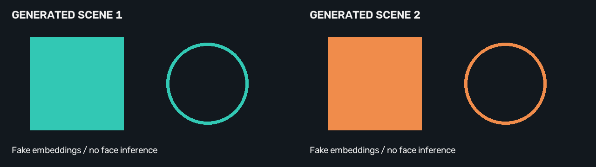

# Edge Camera Lab

A Python camera analytics prototype: local face embeddings, open-set matching,
event recording, and a small FastAPI dashboard. Built around replaceable camera,
inference, and notification adapters, with hardware-independent tests.

The included demo uses generated shapes and a deterministic fake embedder.
It exercises enrollment, consecutive-observation confirmation, and known/unknown
event handling. **It does not detect faces or measure model accuracy.**



## Run the offline demo

Python 3.12 is the verified development version. Create and activate a virtual
environment, then run from the repository root:

```console
python -m pip install -e ".[dev,media]" -c requirements-tested.txt
python -m edge.demo --output runs/demo
```

Expected result: six generated frames produce **one `known_person` event and
one `unknown_person` event**. The new output directory contains `summary.json`,
an abstract PNG preview, and a local SQLite database with synthetic snapshots.
Re-running requires a fresh output directory. No camera, trained model, SMTP
account, or network service is used by this demo.

## What the application implements

- A capture thread and a latest-frame hub, with a motion gate to reduce inference work.
- Cosine-distance matching against a local gallery, with an explicit unknown result
  and rejection of invalid embeddings.
- Consecutive-observation confirmation and notification cooldowns.
- SQLite events, scoped snapshot/clip retrieval, and configurable event retention.
- A Turkish web UI for enrollment, events, live MJPEG, and home/away mode.
- Signed cookie sessions, login throttling, bounded image uploads, and loopback-only
  binding by default. Network binding requires a passphrase of at least 12 characters.
- Optional Pi Camera, local InsightFace/ONNX, Hailo person/cat detection, RTSP capture,
  and SMTP notification adapters.

The service entry point is `python -m edge`; real use requires the optional
dependencies, a camera, and locally provisioned model files. See
[hardware setup](docs/hardware.md) and [architecture](docs/architecture.md).

## Verification and limits

```console
python -m ruff check .
python -m ruff format --check .
python -m mypy edge
python -m pytest -q
```

Tests cover pipeline policy, malformed embeddings/detections, session revocation,
upload limits, media-path traversal, retention, and synthetic JPEG/MP4 handling.
Outbound socket connections are blocked during tests; Windows' internal asyncio
socketpair is allowed. `requirements-tested.txt` records the tested development
environment, including the optional media path.

This portfolio release was checked on Windows with synthetic inputs and fake
inference. **No reproducible recognition-accuracy, false-alarm, FPS, or Pi/Hailo
benchmark is included.** Hardware adapters still require on-device verification.

Recognition has no liveness/anti-spoofing check. Confirmation groups observations
by identity/category; it is not a geometric multi-person tracker. SMTP delivery is
best effort and can delay the analysis loop. `/health` reports process availability,
not camera/model health. This is an engineering prototype, not a certified security
or access-control product.

## Data and dependencies

No real faces, recordings, galleries, credentials, or model weights are included.
The runnable service can collect sensitive data; snapshots and embeddings remain
unencrypted on disk. Optional SMTP sends snapshots outside the device. Removing a
person removes their gallery templates, not historical events or media.
Read the [data flow and retention notes](docs/privacy.md) before using real inputs.

Third-party models have separate terms; in particular, InsightFace's supplied
pretrained weights are restricted to non-commercial research. See
[dependency and model notes](THIRD_PARTY.md). No license grant for the original
application code is included in this snapshot.
