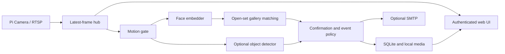

# Architecture

`source.py` captures BGR frames. A daemon thread publishes to `FrameHub`; the
analysis loop samples the latest frame at its configured rate and does not build
an unbounded input queue. The motion gate can skip recognition when pixels are
stable. A skipped interval resets confirmation state.

`embedder.py` exposes a protocol and two implementations: deterministic generated
embeddings for tests, and local InsightFace inference. `matcher.py` compares
512-dimensional unit embeddings against the gallery using cosine distance.
Malformed vectors and invalid thresholds fail closed. The default distance
threshold is a configuration starting point, not a calibrated operating point.

`pipeline.py` confirms repeated identities/categories, applies home/away rules,
stores events and snapshots, and requests optional email or clips. Unknown faces
share a confirmation key; the system does not assign persistent identities or
geometric tracks to unknown people. A recognized owner can switch mode to home;
this should not control a physical lock or other high-consequence action.

`store.py` serializes SQLite access, enables foreign keys, and restricts media
lookups to dedicated subdirectories. `clips.py` buffers encoded frames for
pre/post-roll and verifies the MP4 writer opened. Variable sampling is approximated
by a constant frame rate; playback is not a precise forensic timeline.

`web.py` provides the HTML UI, enrollment, person management, live stream, events,
and media endpoints. The application runs in one process; session secrets and login
throttling are in memory. Restarting invalidates sessions. Do not start multiple
workers against this in-memory state.

`demo.py` constructs abstract frames, enrolls one generated embedding, and sends six
frames through the real policy/store pipeline using fake inference. Its results
verify control flow only. The demo never reads the operator's service settings.
